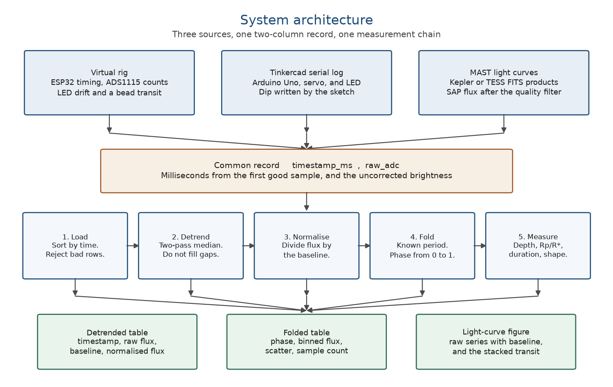
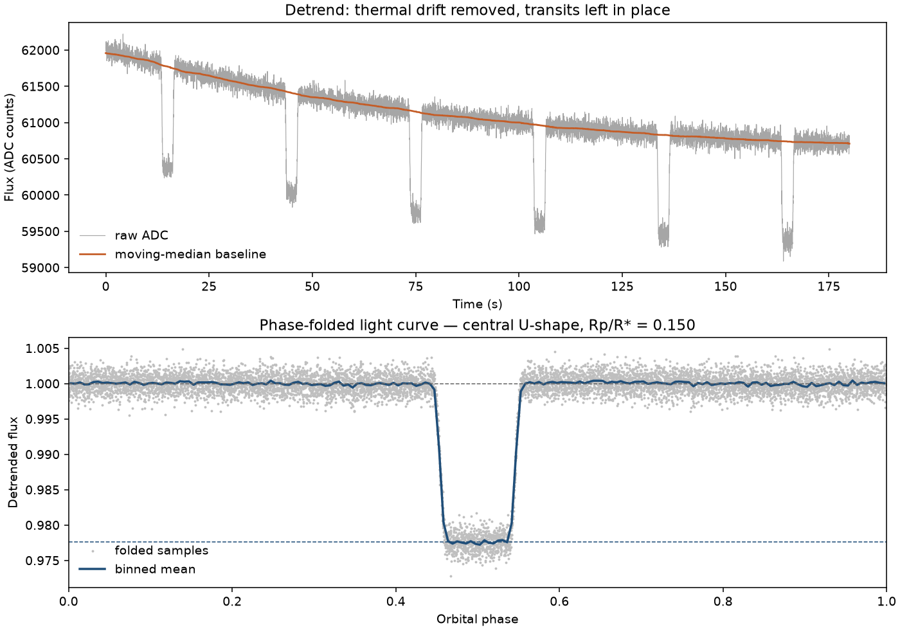

# Transit Photometry Pipeline for a Tabletop Rig and Kepler HAT-P-7

**Capstone Project Report**

Submitted in partial fulfilment of the requirements for the award of the degree of

Bachelor of Engineering

| | |
| --- | --- |
| Institution | [Name of the institution] |
| Department | [Department] |
| Student | [Student name] |
| University Seat Number | [USN] |
| Guide | [Name of the guide] |
| Academic year | 2026–27 |

The name, department, seat number, and guide are left blank because they are not recorded in the project files. Fill those lines before submission. Page numbers in the lists below should be entered after the document is paginated in a word processor.

The technical content, measurements, and sample description are complete.

---

# Acknowledgement

The Kepler photometry used in this project is a public product of the Kepler mission. Kepler was a NASA Discovery mission, and the light curves were obtained from the Mikulski Archive for Space Telescopes (MAST). The export step uses Lightkurve. The host star is HAT-P-7, Kepler ID KIC 10666592, and the planet HAT-P-7b was announced by the HATNet project before Kepler launched.

The author thanks the project guide and the department for supervision and for the time to carry the same measurement from a bench-scale record to a spacecraft record.

# Executive Summary

A planet that passes in front of its star blocks a fraction of the starlight. For a uniform stellar disk and a planet that crosses fully in front of the star, that fraction is the square of the planet-to-star radius ratio. The engineering task is to recover that ratio from a brightness record whose baseline is drifting, gapped, or both, without a separate program for the laboratory and another for the archive.

This project is one Python program, `transit_pipeline.py`, with one input contract. Every source is reduced to two columns, `timestamp_ms` and `raw_adc`. The first column is milliseconds from the first good sample. The second is the uncorrected brightness. Three sources can fill that contract: a simulated ESP32 and ADS1115 rig, a Tinkercad serial log, and a Kepler or TESS light curve downloaded from MAST. The measurement chain is the same after that point. A two-pass moving median removes the slow baseline while leaving the dips in place. The series is folded on a period that is supplied, not searched for. The depth of the stacked dip, its duration, and a simple shape test are then reported. Depth is converted to a radius ratio by taking the square root.

Two records were measured.

The tabletop record is synthetic. It contains 9,000 samples at 50 Hz, covering six orbits of 30 seconds. The planet-to-star radius ratio used to generate it is 0.15, so the true depth is 2.250 percent and the true chord is 3.2 seconds. The program recovered a central U-shaped transit, a depth of 2.239 percent, and a radius ratio of 0.1496 ± 0.0003. The duration came out 3.00 seconds.

The archive record is real Kepler photometry of HAT-P-7. The file `kepler_hat_p_7.csv` holds the first four long-cadence light curves returned by MAST, quarters 0, 1, 2, and 3, from 2 May 2009 through 17 December 2009. Kepler observed this star for about four years. Later quarters are not in the file. After the default quality filter, and after rows with a missing time or flux were removed, 10,311 samples remain. They are spaced about 1,765 seconds apart. The brightness is simple aperture photometry (SAP) in electrons per second, typically about 1.03 million. The corrected PDCSAP flux, the uncertainties, the quality flags, and the rest of the FITS header were not kept. The clock starts again at the first good sample, 2 May 2009. Gaps between quarters are still gaps. On the catalog period of 2.204735 days the file stacks 103.85 orbits. The measured depth is 0.645 percent (6,454 ppm), against a published Kepler depth of 6,674.7 ppm. The radius ratio from that depth is 0.0803 ± 0.0007. The measured duration is 4.12 hours, against a published duration of 3.89 hours. A flatness test labelled the dip a grazing V. The published impact parameter is about 0.22, so the planet is not grazing. That label is a limitation of the test on 30-minute samples, and the report treats it as such.

The program does not discover the orbital period, fit limb darkening, or replace the Kepler pipeline. It shows that one detrending and folding chain can be checked on a record whose answer is known by construction, and then applied, without a change of columns, to the early Kepler light curve of a published planet.

# Table of Contents

| Sec. | Contents | Page |
| --- | --- | --- |
| | Acknowledgement | |
| | Executive Summary | |
| | Table of Contents | |
| | List of Figures | |
| | List of Tables | |
| | List of Abbreviations | |
| 1 | Introduction | |
| 1.1 | Motivation | |
| 1.2 | Literature Survey | |
| 1.3 | Research Gap | |
| 1.4 | Problem Statement and Technical Objectives | |
| 2 | Novelty and Innovative Aspects | |
| 3 | Proposed System and Design Methodology | |
| 3.1 | Design Approach | |
| 3.2 | Proposed Block Diagram / System Architecture | |
| 3.3 | Constraints, Alternatives and Tradeoffs | |
| 4 | Project Implementation and Experimental Setup | |
| 4.1 | Prototype / Simulation / Experimental Setup | |
| 4.2 | Test Conditions, Datasets, Instruments and Procedures | |
| 5 | Project Results and Discussion | |
| 5.1 | Results and Performance Metrics | |
| 5.2 | Comparison with Baselines / Existing Solutions | |
| 5.3 | Validation, Limitations and Discussion | |
| 6 | Project Management and Professional Considerations | |
| 6.1 | Work Breakdown Structure / Timeline | |
| 6.2 | Roles, Teamwork and Resource Management | |
| 6.3 | Technical and Operational Risks and Mitigation | |
| 6.4 | Cost / Economic Considerations | |
| 6.5 | Safety, Legal, Ethical, Social and Environmental Considerations | |
| 7 | Conclusion and Future Scope | |
| 8 | Outcomes of the Project | |
| 9 | References | |
| A1 | Programme Outcome and Programme Specific Outcome Mapping | |
| A2 | Washington Accord Complex Problem-Solving Profile | |
| A3 | Sustainable Development Goal Mapping | |

The source outline numbered the implementation subsections as 5.1 and 5.2, and the management subsections as 10.1 to 10.5. Those headings are retained and renumbered 4.1, 4.2, and 6.1 to 6.5 so that each number is used once.

# List of Figures

| Fig. | Caption | Page |
| --- | --- | --- |
| 1 | System architecture. Three sources share one two-column record and one measurement chain. | |
| 2 | Tabletop record. Six synthetic orbits, with the moving-median baseline and the folded transit. | |
| 3 | Kepler quarters 0–3 of HAT-P-7. SAP flux, baseline, and the folded transit. | |

# List of Tables

| Table | Caption | Page |
| --- | --- | --- |
| 1 | Kepler long-cadence products contained in `kepler_hat_p_7.csv`. | |
| 2 | Rig settings used to generate the tabletop record. | |
| 3 | Measurements against the known tabletop transit. | |
| 4 | Measurements on HAT-P-7 quarters 0–3 against the published transit. | |
| 5 | Work breakdown. | |
| 6 | Indicative cost. | |
| 7 | Programme-outcome contribution. | |
| 8 | Washington Accord problem profiles used in this report. | |
| 9 | Sustainable Development Goal targets. | |

# List of Abbreviations

| Abbreviation | Expansion |
| --- | --- |
| ADC | Analog-to-digital converter |
| ADS1115 | 16-bit analog-to-digital converter used as the rig's detector model |
| BJD | Barycentric Julian Date |
| CSV | Comma-separated values |
| DR25 | Kepler Data Release 25 |
| ESP32 | Embedded microcontroller used as the timing model of the rig |
| FITS | Flexible Image Transport System |
| KIC | Kepler Input Catalog |
| KOI | Kepler Object of Interest |
| MAD | Median absolute deviation |
| MAST | Mikulski Archive for Space Telescopes |
| NASA | National Aeronautics and Space Administration |
| NBA | National Board of Accreditation |
| PDC | Presearch Data Conditioning |
| PDCSAP | PDC simple aperture photometry, the corrected Kepler flux |
| PO | Programme Outcome |
| ppm | Parts per million |
| PSO | Programme Specific Outcome |
| SAP | Simple aperture photometry |
| SDG | Sustainable Development Goal |
| SNR | Signal-to-noise ratio |
| TESS | Transiting Exoplanet Survey Satellite |
| WK | Washington Accord knowledge profile |
| WP | Washington Accord complex-problem profile |

# 1 Introduction

## 1.1 Motivation

The transit method is the main way space missions find planets and measure their sizes. A telescope stares at a star and records brightness against time. Once an orbit, the planet covers part of the star and the record dips. The depth of that dip is the quantity an instrument has to deliver. For a uniform star and a planet that is fully in front of the star at mid-transit, the depth equals \((R_p / R_\star)^2\).

Teaching that measurement usually splits into two exercises that never meet. A bench model, a lamp and a bead on a motor, produces a short, fast, drifting voltage. A published light curve is a multi-month spacecraft product with quarter boundaries, quality flags, and a flux in electrons per second. Students plot one or the other. They rarely run both through the same reduction and ask whether the number that comes out is the radius ratio they were supposed to recover.

That split is an engineering problem, not only a classroom inconvenience. The baseline moves for different physical reasons in the two records, but the operation required of the software is the same: follow the slow change, refuse to treat the dip as part of the baseline, stack the orbits, and report a depth. A program that can do this on a 50 Hz log and on a 30-minute Kepler log is a credible measurement chain. A program that only works on the log it was tuned on is a demonstration.

HAT-P-7b is a suitable archive target because the answer is already published. It is a hot Jupiter found by HATNet and later observed throughout the Kepler mission, where it is also called Kepler-2b. The file used here is only the start of that observation. Saying so is part of the measurement, because a radius quoted from four quarters must not be presented as a radius quoted from four years.

## 1.2 Literature Survey

The geometry of a transit is standard. Winn reviews the observables: depth, duration, impact parameter, and the conversion from depth to a radius ratio when the stellar disk is uniform or limb-darkened [1]. Mandel and Agol give the analytic overlap of two disks, including the quadratic limb-darkening law used by survey pipelines [2]. The simulator in this project uses the uniform-disk case of that overlap. The extractor does not fit the Mandel–Agol model. It measures the binned depth and takes a square root.

HAT-P-7b was reported by Pál and the HATNet collaboration in 2008, before Kepler science operations [3]. The host is a bright F6 star, about magnitude 10.5 in V. The orbit is 2.20473 days. Pál et al. give a planet-to-star radius ratio of \(0.0763 \pm 0.0010\). Kepler then observed the same star as KIC 10666592. Borucki et al. describe the mission and its early planet detections [4]. Koch et al. describe the photometric performance [5]. Jenkins et al. describe the science processing pipeline that turns pixel data into light curves [6].

Kepler long-cadence sampling integrates for about 30 minutes. In the file used here the samples that remain are spaced by a median of 1,765.4 seconds, which is 29.42 minutes. The archive distributes two flux columns. SAP is the sum of the pixels in the aperture, in electrons per second. PDCSAP is that series after Presearch Data Conditioning, the correction for spacecraft systematics described by Smith et al. [7]. This project keeps SAP on purpose. The correction step is a different piece of software, and mixing it into `raw_adc` would hide the baseline the detrending stage is supposed to face.

The NASA Exoplanet Archive compiles the Kepler Data Release 25 solution for this planet [8]. The period adopted there is \(2.204735417\) days. One DR25 solution lists a transit depth of \(6674.7 \pm 1.7\) ppm, a duration of \(3.88864 \pm 0.00203\) hours, and an impact parameter of about 0.22. An impact parameter of 0.22 means the planet crosses the star well inside the limb. The transit is not grazing. Those catalog numbers are the comparison baseline in Section 5. They were fitted to the full Kepler baseline with a limb-darkened model. They are not expected to match a uniform-disk depth from seven months of SAP flux to the last part per million.

Lightkurve is the Python interface used to search MAST and to apply Kepler's quality bitmask [9]. MAST is the archive that holds the FITS products [10]. NumPy and Matplotlib are the array and plotting libraries used for the reduction [11], [12].

## 1.3 Research Gap

Survey pipelines already measure HAT-P-7b more carefully than this project attempts. They model limb darkening, spacecraft pointing, and the full multi-year series, and they search for the period rather than receiving it. Copying that pipeline is not an open problem, and it is not a useful capstone, because the result would be a thin wrapper around existing code.

The open problem is at the other end of the data path. A student instrument, or a short embedded log, does not arrive as a Kepler FITS file. It arrives as a timestamp and a count. Classroom write-ups of lamp-and-ball transits usually stop when a dip is visible. They do not state a radius ratio with an uncertainty, and they do not show that the same function still behaves when the samples are half an hour apart and the series is interrupted for days.

The gap addressed here is the missing common reduction:

- one pair of columns for a rig log and for a MAST export;
- a baseline filter that follows a drift slower than the orbit and still ignores the dip;
- a filter that does not invent samples across a gap;
- a reported radius ratio that can be checked against a value planted in a simulation and against a value published for a real planet.

The period remains an input. On the rig it is the motor setting. On HAT-P-7 it is the catalog period. Finding the period from the data is a different problem and is outside this design.

## 1.4 Problem Statement and Technical Objectives

**Problem statement.** Design a single measurement chain that accepts a two-column brightness log, removes a slow baseline without filling the transit or interpolating gaps, folds the series on a known period, and reports the transit depth, the planet-to-star radius ratio, the duration, and a shape class. Demonstrate the chain on a synthetic rig whose radius ratio is known, and on the Kepler long-cadence SAP light curve of HAT-P-7 from quarters 0–3 only.

**Objectives.**

1. Define a record of `timestamp_ms` and `raw_adc` that a simulator, a Tinkercad serial log, and a MAST download can all write.
2. Generate a rig log with a known radius ratio, a known chord duration, detector noise, and an exponential thermal drift.
3. Remove that drift with a two-pass moving median, masking samples that belong to the dip on the second pass.
4. Use a time window, rather than a fixed sample count, when the sampling is not uniform, and do not interpolate across gaps.
5. Fold on the supplied period, bin the phase, and estimate depth, radius ratio, duration, and whether the dip is a central U or a grazing V.
6. Export the early Kepler light curve of HAT-P-7 into the same record, and state clearly what was kept and what was discarded.
7. Compare the tabletop recovery with the planted values, and compare the Kepler recovery with the published depth, duration, and impact parameter.

# 2 Novelty and Innovative Aspects

The contribution is the contract and the reduction that honours it, not a new planet or a new transit model.

The original pieces are the following.

**One schema for unlike instruments.** A 16-bit bench count and a Kepler SAP flux near \(10^6\) electrons per second are both stored as `raw_adc`. The extractor never branches on the name of the source. It branches only on the time stamps: if the spacing is uniform it uses a sample-count median, and if the spacing is not uniform it uses a window in seconds. That choice is what lets the Kepler file, which contains multi-day gaps, pass through the same function as the 50 Hz rig.

**A second median pass that is not allowed to repair the dip.** A single moving median shorter than the drift and longer than the transit still sags during the transit if the window contains the dip. The first pass is used only to find samples that sit well below the continuum. The second pass recomputes the baseline with those samples excluded, then the flux is divided by that baseline. Division matches a multiplicative model: the star's slow brightness multiplies the fraction of the disk that remains visible.

**Gaps stay gaps.** The Kepler export subtracts the time of the first finite sample and writes milliseconds. It does not resample onto a uniform grid. The gapped median uses only samples that fall inside the time window. Empty windows are filled by interpolation of the baseline, not of the flux, and only so that the baseline exists at every kept sample. The missing cadences are not written back as data.

**A shape test with a stated consequence.** If the bottom of the dip is narrow compared with the width at half depth, the program calls the event a grazing V and reports the radius ratio as a lower limit. A grazing chord never reaches the full area \(\pi R_p^2\), so the square root of the depth underestimates the radius. The test is simple, and Section 5 shows that it misfires on HAT-P-7b. Publishing that failure is part of the result.

What this project does not claim:

- It does not discover HAT-P-7b. The planet and its period were known before this file was downloaded.
- It does not search for the period.
- It does not apply PDCSAP, and it does not fit limb darkening.
- It does not use the full Kepler mission. Quarters after quarter 3 are absent.

The difference from a survey pipeline is scope. The Kepler pipeline is the right tool for a catalog. This program is the right tool for checking that a bench log and a raw archive export can be reduced by the same arithmetic, and for showing where that arithmetic stops agreeing with the catalog.

# 3 Proposed System and Design Methodology

## 3.1 Design Approach

The program has three stages.

**Stage 1, the virtual rig.** Time is sampled at 50 Hz for 180 seconds. The orbital period is 30 seconds, so the run holds six orbits. The unobstructed level starts at 62,000 counts and falls by 1,500 counts with a 90-second time constant, a stand-in for an LED warming up. At each sample the planet's position along a straight chord is computed from the time since mid-transit. The blocked area is the exact intersection of two disks of radii 1 and \(R_p/R_\star\), in units of the stellar radius. The blocked fraction is that area divided by \(\pi\). Gaussian noise of standard deviation 75 counts is added, and the result is clipped to a 16-bit range. The planted radius ratio is 0.15, the impact parameter is 0, and the chord duration is 3.2 seconds. The theoretical depth is \(0.15^2 = 2.25\) percent, or 1,395 counts at the 62,000-count baseline. The single-sample signal-to-noise ratio is \(1395 / 75 = 18.6\).

**Stage 2, extraction.** Rows are read from the CSV and sorted by time. The detrend window defaults to 12 seconds, which is correct for the rig: longer than the 3.2-second transit, shorter than the 90-second thermal time. If the median spacing between samples is so long that a 12-second window holds less than five samples, the window is replaced by 0.4 periods. That rule is what the Kepler file triggers.

The first moving median produces a rough baseline. The flux is divided by it. A robust scale is

\[
\sigma = 1.4826 \times \mathrm{median}(|y - \mathrm{median}(y)|).
\]

Samples more than five of those scales below the continuum are marked as part of a dip. If that mark would cover more than 45 percent of the series, the mark is thrown away, because the threshold has failed and masking almost everything would damage the baseline. The median is then repeated with the marked samples excluded. The detrended flux is the raw flux divided by this second baseline.

Folding uses the supplied period \(P\):

\[
\phi = (t \bmod P) / P.
\]

Phase runs from 0 to 1. The default is 180 bins. If the series is so short that a bin would hold fewer than about four samples, the bin count is reduced. Empty bins are omitted from the folded table.

The continuum of the binned curve is its median. The deepest bin supplies a trial depth. A detection requires that trial depth to exceed five robust scales of the binned continuum. The reported depth is not the single deepest bin. It is the median of the bins that sit in the bottom 15 percent of the trial depth, divided by the continuum. The radius ratio is the square root of that depth. The uncertainty uses the scatter of those bottom bins and the usual propagation \(d(R_p/R_\star) = d(\mathrm{depth}) / (2 R_p/R_\star)\). This is an internal scatter, not a full error budget: it does not include period error, residual baseline, or limb darkening.

Duration is the length of the longest run of bins below a contact level, multiplied by \(P\) over the number of bins. The contact level sits three robust scales below the out-of-transit continuum, or eight percent of the trial depth, whichever cut is deeper. Shape uses the width at 90 percent of the trial depth divided by the width at 50 percent. If that ratio is below 0.70, the dip is called a grazing V and the radius is flagged as a lower limit. Otherwise it is called a central U.

**Stage 3, the archive export.** Lightkurve searches MAST for the target, mission, and cadence. Products are downloaded with the default quality bitmask, which rejects cadences Kepler had already marked bad. For each light curve the SAP flux array is taken. Samples whose time or flux is not finite are dropped. The remaining times, in days, are sorted, the first time is subtracted, and the difference is converted to milliseconds. Flux is written unchanged into `raw_adc`. Nothing is interpolated.

The Tinkercad path is a documented Arduino sketch rather than a fourth algorithm. The circuit is an Arduino Uno, a servo, a red LED, and a potentiometer read on A0. Tinkercad does not cast light from the LED onto a sensor, so the sketch multiplies the A0 reading by a flat-bottomed dip while the servo passes mid-orbit. The serial lines are `timestamp_ms,raw_adc`. The orbit in the sketch is 10 seconds and the planted radius ratio is again 0.15. No Tinkercad log was reduced for the numbers in Section 5. The sketch is the procedure for a later hardware run.

Governing relations used by the extractor, collected in one place:

- Blocked fraction for a full, central, uniform-disk transit: \(\delta = (R_p / R_\star)^2\).
- Recovered ratio: \(R_p / R_\star = \sqrt{\delta}\).
- Robust scale: \(1.4826\) times the median absolute deviation, the usual conversion that matches a standard deviation for Gaussian noise.
- Phase: time modulo the supplied period.

## 3.2 Proposed Block Diagram / System Architecture

Figure 1 is the architecture. The three sources differ in hardware and in units. They meet at one record. After that record, the path is load, detrend, divide, fold, and measure. The chain writes a detrended table, a folded table, and a two-panel figure.

The arrows into the output row mean that the chain as a whole produces those three files. They are not three optional results of step 5 alone. The detrended table is available once the baseline exists. The folded table and the figure need the fold and the measurement.



Inputs and outputs:

| Point | What crosses it |
| --- | --- |
| Into the record | A simulator row, a serial line, or a SAP sample that survived the quality filter |
| Into detrend | Time in seconds, flux, a window in seconds, and a clip threshold of 5 robust scales |
| Into the fold | Detrended flux and the supplied period |
| Out of the program | Depth, radius ratio and its internal uncertainty, duration, shape class, two CSV files, and a PNG |

## 3.3 Constraints, Alternatives and Tradeoffs

**The period is given.** A search over period would make the program look more automatic and would also make a wrong period harder to notice. The rig's motor and the catalog both already provide \(P\). Spending the design on the baseline and the depth keeps the failure modes interpretable. The cost is that a wrong period, if typed in, folds the dip into the noise and the program reports no transit. That is a safer failure than a confident radius at the wrong period.

**SAP rather than PDCSAP.** PDCSAP is cleaner. Using it would improve the Kepler residual and would also move the hard part of the problem into Lightkurve, where this project would not have done it. SAP leaves the quarter-to-quarter jumps in the file. Those jumps are larger than the HAT-P-7 transit, which is the reason a baseline stage is required at all. The cost is a few percent of disagreement with a catalog fit that used the corrected, limb-darkened, full-mission series.

**Window length.** A short window tracks a fast drift and also tracks the dip, which fills the transit back in when the flux is divided by the baseline. A long window ignores the dip and also ignores real baseline changes inside the window. The rig uses 12 seconds. The Kepler path uses 0.4 periods, about 21.2 hours, which is several times the four-hour transit and still shorter than a quarter. The 0.4 factor is a rule of thumb, not a fitted optimum.

**Mean in phase bins, median in time.** The baseline uses a median because a few in-transit points should not pull it. The phase bin uses a mean because the quantity of interest is the average blocked light, and the bin already contains many orbits. A median of the phase bin would be more resistant to outliers and slightly biased for a U-shaped dip whose samples are not symmetric in the bin.

**No interpolation of missing cadences.** Resampling the Kepler series onto an even grid would let a textbook filter run unchanged. It would also invent brightness during the days when the spacecraft was not taking data, and those invented points would enter the fold. The time-based median is more code and an honest gap.

**Uniform-disk square root rather than a limb-darkened fit.** A Mandel–Agol fit with a free impact parameter would match the catalog definition of \(R_p/R_\star\) more closely. It needs stellar limb-darkening coefficients and a non-linear optimiser, and it would hide the plain geometric relation the rig is meant to teach. The project keeps the square root and compares depth with depth, which is the fair comparison. The catalog radius ratio is cited so the difference is visible, and it is not used as a pass-fail number.

**Shape threshold at 0.70.** The threshold is a single number chosen so that a flat-bottomed rig transit passes and a V does not. Section 5 shows HAT-P-7b landing at 0.67 and being called grazing even though the catalog impact parameter is about 0.22. Lowering the threshold until this one planet passed would be fitting the test to the answer. The threshold is left as it is, and the false grazing call is reported.

# 4 Project Implementation and Experimental Setup

## 4.1 Prototype / Simulation / Experimental Setup

The implementation is one file, `transit_pipeline.py`, run with Python 3. The numerical work uses NumPy. Figures use Matplotlib. The archive download uses Lightkurve 2.6. No microcontroller was flashed for the numbers in this report. The rig is a numerical model of an ESP32 loop reading an ADS1115, with the settings in Table 2. The random seed is fixed at 42, so the same 9,000 rows are regenerated on every run.

The archive side is not a simulation. `kepler_hat_p_7.csv` was exported from real Kepler FITS products. The reduction of that file does not need a network connection. A fresh download is a separate command and was not required for the measurements below, because the CSV was already on disk.

Commands used for the two measured cases:

```text
python3 transit_pipeline.py extract tabletop
python3 transit_pipeline.py extract kepler
```

The Kepler run prints that the 12-second rig window is shorter than the sampling and replaces it with 76,195.7 seconds, which is 0.4 times the 190,489.14-second period. Both runs write a detrended CSV, a folded CSV, and a two-panel PNG.

The Tinkercad setup, when it is built, uses an Arduino Uno, a hobby servo on pin D9, a red LED driven from D6 through 220 ohms, and a potentiometer on A0. The sketch prints the CSV header and one row every 100 milliseconds. That setup was not operated for this report. It is recorded so the hardware step has a defined wiring and a defined serial contract.

## 4.2 Test Conditions, Datasets, Instruments and Procedures

### Dataset A — tabletop telemetry

`tabletop_telemetry.csv` is generated, not observed. It has 9,000 rows. The span is 180.0 seconds and the median spacing is 0.020 seconds. Columns are `timestamp_ms` and `raw_adc`. The median level is about 61,000 counts, below the 62,000-count starting baseline because the LED model cools the count rate over the run. There are no gaps.

**Table 2. Rig settings used to generate the tabletop record.**

| Setting | Value |
| --- | --- |
| Sample rate | 50 Hz |
| Duration | 180 s (9,000 samples) |
| Orbital period | 30 s (six orbits) |
| Transit chord | 3.2 s |
| Planet-to-star radius ratio | 0.15 |
| Impact parameter | 0 (central) |
| True depth | 2.250 percent (1,395 counts) |
| Baseline | 62,000 counts |
| Noise, standard deviation | 75 counts |
| Thermal drop and time constant | 1,500 counts, 90 s |
| Single-sample SNR | 18.6 |
| Random seed | 42 |

The extraction period is 30 seconds and the detrend window is 12 seconds. Phase bins stay at 180.

### Dataset B — Kepler HAT-P-7, quarters 0 to 3

`kepler_hat_p_7.csv` is real Kepler photometry of the star HAT-P-7, Kepler ID KIC 10666592. It is the first four light curves MAST returned, not the whole mission. Kepler observed this star for about four years. Those later quarters are not in the file.

**Table 1. Kepler long-cadence products contained in `kepler_hat_p_7.csv`.**

| Quarter | Dates | Product |
| --- | --- | --- |
| 0 | 2–11 May 2009 | kplr010666592-2009131105131_llc.fits |
| 1 | 13 May–15 June 2009 | kplr010666592-2009166043257_llc.fits |
| 2 | 20 June–16 Sep 2009 | kplr010666592-2009259160929_llc.fits |
| 3 | 18 Sep–17 Dec 2009 | kplr010666592-2009350155506_llc.fits |

Each product is a Kepler long-cadence light curve. One exposure is 30 minutes, and the samples in the file are spaced about 1,765 seconds apart. The measured median spacing is 1,765.4 seconds. The brightness column is SAP flux, simple aperture photometry, in electrons per second. The corrected PDCSAP flux was left behind, along with the errors, the quality flags, and the rest of the FITS header.

Lightkurve's default quality filter removed cadences Kepler had already marked bad. Any remaining row with a missing time or flux was dropped too. What is left is 10,311 readings. The clock is restarted at the first good sample, 2 May 2009, so `timestamp_ms` is milliseconds since then. The last sample is \(1.978190555 \times 10^{10}\) milliseconds later, a span of 228.96 days, which ends in mid-December 2009 and matches the end of quarter 3. Gaps between quarters are still gaps. `raw_adc` is that SAP flux. The median value is 1,032,530 electrons per second, and the series runs from about 1,019,038 to 1,037,500.

The quarter breaks are visible in the time stamps once they are added back onto 2 May 2009. A gap of 1.27 days follows day 9.7, which is the break from 11 May to 13 May between quarters 0 and 1. A gap of 4.78 days follows day 44.4, which is the break from 15 June to 20 June between quarters 1 and 2. A gap of 1.76 days follows day 137.9, which is the break from 16 September to 18 September between quarters 2 and 3. Shorter interruptions inside a quarter are also left as gaps. None of them were filled with interpolated flux.

The period supplied to the extractor is 190,489.14 seconds, which is 2.204735 days, the Kepler DR25 period. The program does not estimate it. At that period the 228.96-day span stacks 103.85 orbits. A four-year mission at the same period would stack on the order of 660 orbits. This file is the early part of the observation, about one sixth of the mission length.

Because the flux errors were not exported, the ± figure reported for the Kepler radius ratio is the scatter of the phase bins at the bottom of the dip. It is not the uncertainty Kepler published, and it does not include the SAP systematic error.

### Procedure

1. Confirm the CSV header is `timestamp_ms,raw_adc`.
2. Sort by time. Reject a file with fewer than ten numeric rows.
3. Select the detrend window: 12 seconds on the rig, 0.4 periods when the cadence is longer than that window.
4. Run the two-pass median. Record how many samples were masked as in-transit.
5. Fold into 180 phase bins and measure depth, radius ratio, duration, and shape.
6. Write the detrended table, the folded table, and the figure.
7. For the rig, compare with the planted depth, radius ratio, duration, and shape.
8. For HAT-P-7, compare depth and duration with the NASA Exoplanet Archive DR25 values, and compare the shape label with the published impact parameter.

The same steps run for both files. Only the period and, when the cadence demands it, the window change.

# 5 Project Results and Discussion

## 5.1 Results and Performance Metrics

### Tabletop

The generated log and the extraction print the following. Six orbits are captured. The planted depth is 2.250 percent. The single-sample SNR is 18.60. The extractor loads 9,000 samples spanning 180.0 seconds, uses the 12.0-second window, and masks 857 samples as in-transit. It reports a central U, a depth of 2.239 percent, a radius ratio of \(0.1496 \pm 0.0003\), and a duration of 3.00 seconds. The flatness ratio, width near the bottom over width at half depth, is 0.875, above the 0.70 grazing cut.

Figure 2 shows the run. The upper panel is the raw count, falling by roughly a thousand counts as the thermal model settles, with six dips of about 1,400 counts. The orange baseline follows the fall and bridges each dip instead of dropping into it. The lower panel stacks all six orbits. The out-of-transit level sits at 1. The floor of the U sits just under 0.978, which is a 2.2 percent dip. Individual samples scatter by about the 75-count noise, and the binned mean is flat across the bottom.



**Table 3. Measurements against the known tabletop transit.**

| Quantity | Planted | Recovered | Difference |
| --- | --- | --- | --- |
| Depth | 2.250 percent | 2.239 percent | −0.011 percentage points (−0.5 percent relative) |
| \(R_p / R_\star\) | 0.1500 | 0.1496 ± 0.0003 | −0.0004 (−0.27 percent relative) |
| Duration | 3.20 s | 3.00 s | −0.20 s (−6.3 percent relative) |
| Shape | Central, impact parameter 0 | Central U | Agrees |
| Samples masked | Chord is 10.7 percent of the orbit | 857 of 9,000 (9.5 percent) | Consistent with the chord |

The radius error, 0.0004, sits just outside the 0.0003 internal scatter. The remaining bias is small and in the expected direction: a finite bin and a contact rule shorten the event, and any baseline that still lifts slightly during the dip shallows it. The duration is short by one bin scale. At 180 bins a 30-second orbit is 0.167 seconds per bin, and the contact threshold does not sit exactly at first and fourth contact. A 0.2-second error on a 3.2-second chord is the resolution of this duration definition, not a missed transit.

### Kepler quarters 0–3

The extractor loads 10,311 samples spanning \(1.978 \times 10^7\) seconds, reports 103.85 orbits, and replaces the rig window with 76,195.7 seconds. It masks 819 samples. It reports a grazing V, a depth of 0.645 percent, a radius ratio of \(0.0803 \pm 0.0007\) marked as a lower limit, and a duration of 14,816 seconds (4.12 hours). The flatness ratio is 0.667.

Figure 3 is that reduction. The upper panel is plotted against seconds since 2 May 2009, out to about \(2 \times 10^7\) seconds. The SAP flux sits near \(1.03 \times 10^6\) electrons per second. Quarter-to-quarter offsets of order 10,000 electrons per second, about one percent, are larger than the transit, which is 0.65 percent. The orange baseline follows those offsets and the slow drift inside a quarter. The narrow downward spikes are the individual transits. They remain after the baseline is divided out. The lower panel is the stack of 103.85 orbits. The dip is centred near phase 0.4, reaches about 0.9935, and the binned curve is narrow compared with the orbit, as a four-hour event in a 2.2-day period should be.


The plot title uses the words "thermal drift" and "ADC counts" because the figure function is shared with the rig. On this file the orange curve is the moving median of SAP flux, and the vertical axis is electrons per second. The caption above is the correct reading of the axes.

**Table 4. Measurements on HAT-P-7 quarters 0–3 against the published transit.**

| Quantity | This reduction (Q0–Q3 SAP) | Published value | Difference |
| --- | --- | --- | --- |
| Period used | 2.204735 days, supplied | 2.204735417 days, DR25 [8] | Supplied, not fitted |
| Depth | 6,454 ppm (0.645 percent) | 6,674.7 ± 1.7 ppm [8] | −221 ppm (−3.3 percent relative) |
| \(R_p / R_\star\) from \(\sqrt{\mathrm{depth}}\) | 0.0803 ± 0.0007 | 0.0817 if taken from the published depth; 0.0763 ± 0.0010 in Pál et al. [3] | −1.7 percent against \(\sqrt{6674.7\,\mathrm{ppm}}\) |
| Duration | 4.12 h | 3.889 ± 0.002 h [8] | +0.23 h (+5.8 percent relative) |
| Geometry | Shape test: grazing V, flatness 0.67 | Impact parameter about 0.22 [8], not grazing | Test disagrees with the catalog |
| Series used | 10,311 samples, 229 days, 104 orbits | Full Kepler baseline, about four years | This file is the early quarters only |

The depth agreement, 3.3 percent relative, is the primary performance number. It is much larger than the formal DR25 uncertainty of 1.7 ppm, and it should be. The DR25 uncertainty is the fit error on the full corrected series. This reduction uses seven months of uncorrected SAP flux, a median filter, and no limb darkening. A residual of 221 ppm on a 6,675 ppm transit is a successful recovery at the level this design can support.

## 5.2 Comparison with Baselines / Existing Solutions

Three baselines are the right ones. A fourth, "did the plot show a dip", is not used.

**Planted rig parameters.** Table 3 is a closed test. The depth and the radius ratio return to 0.5 percent and 0.27 percent relative. The shape class is correct. This is the evidence that the two-pass median does not eat a transit when the window is set between the chord and the drift, and that the square-root conversion is implemented as specified.

**Kepler DR25 depth and duration.** Table 4 is an open test on data the program did not generate. Depth is 3.3 percent shallower than 6,674.7 ppm. Duration is 5.8 percent longer than 3.889 hours. Both are outside the catalog's formal errors and inside the systematic floor expected from 30-minute sampling, a contact threshold, and SAP jumps of about one percent. The square root of the measured depth, 0.0803, is 1.7 percent below the square root of the catalog depth. It is 5 percent above Pál et al.'s limb-darkened radius ratio of 0.0763. Those two published radii differ from each other because they are not the same parameter. Pál et al. fitted a limb-darkened transit. The square root of a Kepler depth is closer to a central surface-brightness depth than to that fitted ratio. Comparing this project with \(\sqrt{\mathrm{depth}}\) is the consistent check. Comparing it with 0.0763 and calling the difference an error would mix two definitions.

**Doing nothing to the baseline.** The upper panel of Figure 3 is the control. Quarter offsets of about one percent exceed the 0.65 percent transit. Folding the raw SAP flux without the median would stack those offsets into the phase curve and move the continuum by more than the dip. The masked-sample count, 819 of 10,311, is about 7.9 percent of the points. A four-hour transit in a 52.9-hour period is 7.6 percent of the orbit, so the mask is landing on the transits rather than on the quarter jumps.

**Survey pipelines.** The Kepler pipeline plus a transit fit remains the better estimator of the catalog radius. It uses PDCSAP or an equivalent correction, pixel-level diagnostics, limb darkening, and the quarters this file does not contain. This project is not offered as a replacement. The comparison that favours the project is different: the same 200 lines of reduction that recover a planted 0.15 on a drifting 16-bit log also recover a 6,454 ppm depth from a gapped SAP series. A pipeline that cannot read `timestamp_ms,raw_adc` does not answer that question. A rig script that cannot leave a quarter gap unfilled does not either.

No Tinkercad capture is in the comparison, because none was recorded. The sketch is specified so that a later log can be scored against the same 0.15 radius ratio.

## 5.3 Validation, Limitations and Discussion

The tabletop result validates the arithmetic. The noise, the drift, and the chord are all present, and the recovered radius lies within 0.0004 of the planted value. Regenerating the file with seed 42 reproduces the test.

The Kepler result validates the data path. The sample count is 10,311. The span matches quarters 0–3. The large gaps fall at the published quarter boundaries. The folded dip is unique, narrow, and about 0.65 percent deep, which is the HAT-P-7b transit and not a filter artifact. A filter artifact would not land 3 percent away from the published depth and would not last about four hours.

The limitations are specific.

**The grazing label is wrong for this planet.** Flatness of 0.67 fell below 0.70, so the program printed "lower limit" and "grazing V-shape". The DR25 impact parameter is about 0.22. The planet is fully silhouetted at mid-transit. Long-cadence sampling is part of the cause. Ingress and egress of HAT-P-7b are short compared with a 30-minute exposure, so the flat bottom is rounded in the samples that remain, and a 180-bin fold is about 18 minutes wide. The bottom then looks narrower than the half-depth width. The radius 0.0803 is still the square root of the measured depth. It should be read as that number, not as a physical lower bound. The flag did what the threshold says. The threshold is the weak part.

**The series is not the mission.** Four years of Kepler data exist for KIC 10666592. This CSV stops on 17 December 2009. A tighter residual would be expected from the later quarters, and it is not claimed here.

**SAP systematics remain.** PDCSAP was discarded. The one-percent quarter jumps are removed only to the extent that a 21-hour median follows them. Structure faster than the window and slower than the transit can still bias the depth at the level of the 221 ppm residual.

**The quoted ±0.0007 is not a total uncertainty.** The SAP errors never entered the CSV. The ±0.0007 is the bin scatter at the bottom of the fold, propagated through the square root. The 221 ppm catalog residual is a more honest external error than the internal ±0.0007.

**Duration is a threshold width.** The same definition that returned 3.00 seconds against a 3.20-second chord returned 4.12 hours against 3.89 hours. The fractional duration error is similar in the two tests, about six percent. That is the accuracy of this duration estimator. It is not evidence of a different orbit.

**The period was not tested.** Both runs were given the correct period. The design does not claim to notice a wrong one beyond failing the five-sigma depth cut.

**The rig has not been built in hardware.** The tabletop numbers are a seeded simulation of the intended front end. They include the noise and the drift the front end was assumed to have. They do not include optical misalignment, a servo that does not hold a constant speed, or mains pickup. The Tinkercad sketch has a further limit of its own: the dip is multiplied in software, because the simulator has no optical path.

**Shared figure labels.** The Kepler figure says "thermal drift" and "ADC counts". Those words are accurate for the rig and only metaphorical for SAP flux. The measurement is unaffected. The caption in this report is the wording that should be used when the figure is shown.

Within those limits, the problem stated in Section 1.4 is met. One chain, one pair of columns, a planted radius recovered to 0.27 percent relative, and a real seven-month Kepler depth recovered to 3.3 percent relative.

# 6 Project Management and Professional Considerations

## 6.1 Work Breakdown Structure / Timeline

The work breaks into six packages. The week numbers are a 16-week semester plan, not a claim about which calendar day each package finished. The department calendar should be written into the right-hand column before submission.

**Table 5. Work breakdown.**

| Package | Work | Depends on | Semester plan |
| --- | --- | --- | --- |
| 1. Problem and literature | Transit geometry, SAP versus PDCSAP, HAT-P-7 catalog values, choice of a known planet | — | Weeks 1–3 |
| 2. Contract and rig model | Two-column CSV, disk-overlap simulator, thermal drift, fixed seed | Package 1 | Weeks 3–6 |
| 3. Extractor | Two-pass median, gapped window, fold, depth, shape test, plots | Package 2 | Weeks 6–10 |
| 4. Archive export | MAST search, quality bitmask, SAP-only export, clock restart, gap preservation | Package 2 | Weeks 8–11 |
| 5. Validation | Tabletop against planted values; HAT-P-7 Q0–Q3 against DR25 depth, duration, and impact parameter | Packages 3 and 4 | Weeks 11–14 |
| 6. Report | This document, figures, PO / WP / SDG mapping | Package 5 | Weeks 14–16 |

Packages 3 and 4 can overlap. The extractor was written against the rig first, then run unchanged once the Kepler CSV existed. That order is what makes the Kepler result a test rather than a tuning set.

## 6.2 Roles, Teamwork and Resource Management

The project is written up as an individual capstone. One author owns the simulator, the extractor, the archive export, the validation, and the report. The guide reviews the problem statement, the decision to keep SAP, and the interpretation of the Kepler residual. No other team roles are claimed, because none are recorded in the project files.

The computing resource is a personal computer with Python, NumPy, Matplotlib, and Lightkurve. The Kepler CSV is a local file of 10,311 rows, so the measurement itself does not depend on a live archive connection. A fresh MAST download does. Disk use is dominated by the FITS cache if a download is repeated, not by the CSV.

If the department assigned a team, the natural split is the one the packages already have: one person on the rig and the serial contract, one on the extractor, one on the archive export and the catalog comparison. That split is a recommendation, not a description of work that was divided.

## 6.3 Technical and Operational Risks and Mitigation

| Risk | What would go wrong | What the design does |
| --- | --- | --- |
| Detrend window shorter than the transit | The baseline follows the dip and division removes the signal | Rig window is 12 s against a 3.2 s chord. Kepler window is forced to 0.4 periods when the cadence is long. |
| Window longer than the drift | Quarter jumps and LED warm-up remain in the folded curve | 12 s is well under the 90 s thermal time. The 21-hour Kepler window still follows the offsets visible in Figure 3. |
| Gaps filled by resampling | Invented samples enter the fold and bias the continuum | Export writes only finite cadences. The median is taken in a time window. |
| Wrong period typed in | The dip is smeared across phase and may fall below five sigma | The period is an explicit argument. The run prints the period it used. |
| Treating Q0–Q3 as the whole mission | The report would overstate the evidence | Table 1, the span, and Section 5 state the four products and the four-year limit. |
| Reading the grazing flag as a property of HAT-P-7b | A false geometric claim | Section 5.3 compares the flag with the catalog impact parameter and withdraws the physical reading. |
| Using the internal ± as a catalog error | False precision | The SAP uncertainties were not kept. The external residual, 221 ppm, is stated beside the internal ±0.0007. |
| Tinkercad mistaken for an optical measurement | The dip would be described as detected light | The sketch applies the dip because the simulator has no light path. Section 4.1 says no such log was reduced. |
| MAST unavailable during a demo | The live download fails | The measured file is already stored as `kepler_hat_p_7.csv`. |

## 6.4 Cost / Economic Considerations

The measurements reported here have no instrument cost. The software is free and open source. The Kepler products are public. The computer is assumed to be one the student already has, and it is not priced as a project purchase.

A physical copy of the rig, if it is built later, is a small bill of materials. The prices below are indicative retail figures for 2026, in Indian rupees, for a single bench unit. They are not quotations.

**Table 6. Indicative cost.**

| Item | Role | Indicative cost (INR) |
| --- | --- | --- |
| ESP32 development board | Sample clock and logger | 400 |
| ADS1115 module | 16-bit detector reading | 250 |
| Servo | Orbit | 200 |
| LED, diffuser, bead, resistor | Star, planet, aperture | 150 |
| Breadboard and wire | Assembly | 200 |
| Tinkercad, Python, Lightkurve, MAST | Design, reduction, archive | 0 |
| **Indicative rig total** | | **about 1,200** |

Against that, the scientific comparison data would otherwise require a photometric telescope and a multi-month campaign. Using the public Kepler archive is the economic decision that makes the second test possible in a capstone. It does not create a commercial product, and no revenue is claimed.

## 6.5 Safety, Legal, Ethical, Social and Environmental Considerations

**Safety.** The reported work is software and a public data file. Voltages in the intended rig and in the Tinkercad circuit are the 5 V and 3.3 V rails of a microcontroller board. The LED current is limited by a series resistor. There is no laser, no high voltage, and no human subject.

**Legal and citation.** Kepler light curves are public scientific data. They are not the author's measurements. The report names the mission, MAST, the Kepler ID, the four product filenames, and the quarters. The planet is not claimed as a discovery. HAT-P-7b was published in 2008 [3]. Reproducing a depth is the point of the test.

**Ethics of the number.** Three temptations are refused in the text. The first is to describe 10,311 samples as the Kepler mission. The second is to quote \(0.0803 \pm 0.0007\) as if the uncertainty included SAP systematics and limb darkening. The third is to leave the grazing flag unqualified. Each of those would make the result look stronger than the evidence. The professional obligation is the opposite: the partial series, the missing error column, and the failed shape test are in Section 5, next to the depth that succeeded.

**Social and educational effect.** The useful social product is a measurement a later student can rerun. The CSV contract, the seeded simulator, and the stored Kepler extract make the result checkable without a telescope. That is a teaching gain. It is not a claim about public policy.

**Environment.** No laboratory waste, propellant, or observing-site impact was generated. Reusing the archive avoids a redundant observing run. The effect is real and very small, and it is not counted as an environmental outcome beyond the SDG note in Annexure 3.

# 7 Conclusion and Future Scope

A single program reads a timestamp and a brightness, removes a slow baseline without filling gaps or the transit, folds on a supplied period, and reports a depth and a radius ratio.

On the synthetic rig the planted radius ratio is 0.15. The recovered value is 0.1496 ± 0.0003, the depth is 2.239 percent against 2.250 percent, the shape is a central U, and the duration is 3.00 seconds against 3.20 seconds.

On HAT-P-7 the input is the real Kepler SAP light curve of KIC 10666592 for quarters 0, 1, 2, and 3 only: 10,311 samples at about 1,765 seconds, from 2 May 2009, with the quarter gaps left open and with PDCSAP left out. The recovered depth is 6,454 ppm against a published 6,674.7 ppm. The duration is 4.12 hours against 3.89 hours. The shape test calls the dip grazing. The published impact parameter says it is not, and that call is not adopted as a property of the planet.

Future work, in the order that would most improve the evidence:

1. Build the optical rig, log it through the same CSV, and score it against a measured bead and aperture rather than against a planted 0.15.
2. Run the Tinkercad sketch only as a wiring check, and do not treat its multiplied dip as photometry.
3. Add the later Kepler quarters as a separate file, still without interpolating the gaps, and repeat Table 4.
4. Export the SAP uncertainty and propagate it, so the ± on the radius is not only the bin scatter.
5. Replace the 0.70 flatness cut with a duration-and-cadence test, after checking it on a planet that really is grazing and on one that is not.
6. Only after those checks, fit a limb-darkened model if the aim becomes a catalog-definition radius rather than a depth.

Searching for the period is intentionally not the next step. The present design is a measurement of depth given the period. Mixing a search into it would change the question the tables answer.

# 8 Outcomes of the Project

The concrete outcomes are:

- `transit_pipeline.py`, covering the rig model, the two-pass gapped detrend, the fold and measurement, the MAST export, and the Tinkercad sketch.
- `tabletop_telemetry.csv`, 9,000 rows, seed 42, with a known transit.
- `kepler_hat_p_7.csv`, 10,311 rows of HAT-P-7 SAP flux from Kepler quarters 0–3, clock restarted at 2 May 2009.
- Detrended and folded tables and the two light-curve figures used in Section 5.
- A closed-test radius error of 0.27 percent relative on the rig.
- An open-test depth residual of 3.3 percent relative on HAT-P-7 quarters 0–3, with the mission length, the missing PDCSAP column, and the false grazing flag stated in the same place as the residual.

No patent, startup, or new astronomical discovery is an outcome of this project.

# 9 References

[1] J. N. Winn, "Exoplanet transits and occultations," in *Exoplanets*, S. Seager, Ed. Tucson, AZ, USA: University of Arizona Press, 2010, pp. 55–77.

[2] K. Mandel and E. Agol, "Analytic light curves for planetary transit searches," *Astrophysical Journal Letters*, vol. 580, no. 2, pp. L171–L175, 2002.

[3] A. Pál *et al.*, "HAT-P-7b: An extremely hot massive planet transiting a bright star in the Kepler field," *Astrophysical Journal*, vol. 680, no. 2, pp. 1450–1456, 2008.

[4] W. J. Borucki *et al.*, "Kepler planet-detection mission: Introduction and first results," *Science*, vol. 327, no. 5968, pp. 977–980, 2010.

[5] D. G. Koch *et al.*, "Kepler mission design, realized photometric performance, and early science," *Astrophysical Journal Letters*, vol. 713, no. 2, pp. L79–L86, 2010.

[6] J. M. Jenkins *et al.*, "Overview of the Kepler science processing pipeline," *Astrophysical Journal Letters*, vol. 713, no. 2, pp. L87–L91, 2010.

[7] J. C. Smith *et al.*, "Kepler presearch data conditioning II — A Bayesian approach to systematic error correction," *Publications of the Astronomical Society of the Pacific*, vol. 124, no. 919, pp. 1000–1014, 2012.

[8] NASA Exoplanet Archive, "HAT-P-7 b," IPAC, California Institute of Technology. [Online]. Available: https://exoplanetarchive.ipac.caltech.edu/overview/HAT-P-7%20b. Kepler DR25 values used here: period 2.204735417 days, transit depth 6674.7 ± 1.7 ppm, duration 3.88864 ± 0.00203 hours, impact parameter about 0.22.

[9] Lightkurve Collaboration, "Lightkurve: Kepler and TESS time series analysis in Python," Astrophysics Source Code Library, ascl:1812.013, 2018.

[10] Space Telescope Science Institute, "Mikulski Archive for Space Telescopes." [Online]. Available: https://archive.stsci.edu/

[11] C. R. Harris *et al.*, "Array programming with NumPy," *Nature*, vol. 585, pp. 357–362, 2020.

[12] J. D. Hunter, "Matplotlib: A 2D graphics environment," *Computing in Science & Engineering*, vol. 9, no. 3, pp. 90–95, 2007.

[13] International Engineering Alliance, *Graduate Attributes and Professional Competencies*, version 2021. Washington Accord knowledge profiles WK1–WK8 and complex-problem profiles WP1–WP7.

[14] United Nations General Assembly, "Transforming our world: the 2030 Agenda for Sustainable Development," resolution A/RES/70/1, 2015. Targets 4.4 and 9.5.

[15] National Board of Accreditation, *Manual for Accreditation of Undergraduate Engineering Programmes*. Programme Outcomes PO1–PO12 as adopted for Tier-I / Washington Accord programmes.

# Annexure 1 Programme Outcome (PO) and Programme Specific Outcome (PSO) Mapping and Justification with WKs

Contribution is scored 1 (low), 2 (medium), or 3 (high). The score is the extent to which this project required that outcome, judged from the work above. It is not a cohort attainment percentage. The department's approved scale should replace this one if it differs.

WK1 is systematic natural science. WK2 is mathematics, numerical analysis, and statistics. WK3 is theory-based engineering fundamentals. WK4 is specialist engineering knowledge. WK5 is knowledge that supports engineering design. WK6 is engineering practice in the discipline. WK7 is the role of engineering in society, ethics, and impacts. WK8 is engagement with the research literature. Definitions follow the Washington Accord graduate attributes [13].

The PO statements follow the NBA undergraduate engineering outcomes [15]. PO12, lifelong learning, is included because the NBA list has twelve outcomes. Drop that row if the department's sheet stops at PO11.

**Table 7. Programme-outcome contribution.**

| Outcome | Level | Knowledge profiles |
| --- | --- | --- |
| PO1 Engineering knowledge | 3 | WK1, WK2, WK3 |
| PO2 Problem analysis | 3 | WK1, WK2, WK4, WK8 |
| PO3 Design and development of solutions | 3 | WK3, WK4, WK5 |
| PO4 Investigation of complex problems | 3 | WK2, WK4, WK8 |
| PO5 Modern tool usage | 3 | WK2, WK6 |
| PO6 Engineer and society | 2 | WK7 |
| PO7 Environment and sustainability | 1 | WK7 |
| PO8 Ethics | 3 | WK7 |
| PO9 Individual and team work | 1 | WK6 |
| PO10 Communication | 2 | WK6 |
| PO11 Project management and finance | 2 | WK6, WK7 |
| PO12 Lifelong learning | 2 | WK8 |

**PO1 — level 3.** The depth-to-radius step is the disk-area relation \(\delta = (R_p/R_\star)^2\). The simulator implements the circle-circle intersection. The robust scale uses the median absolute deviation. The phase fold is modular arithmetic on a supplied period. These are applied, not only named: Table 3 shows the square root returning 0.1496 from a planted 0.15, and Table 4 shows it returning 0.0803 from a measured Kepler depth.

**PO2 — level 3.** The problem had to be separated into a baseline component and a dip component, and into a uniform 50 Hz log and a gapped 30-minute log. The literature review identifies SAP, PDCSAP, and the DR25 catalog as different products [6], [7], [8]. The conclusion that a 12-second window is illegal for Kepler data is a formulated analysis of the cadence, and the program acts on it by switching to 0.4 periods. The five-sigma detection rule and the 45-percent mask reject are checks that the formulation can fail, with a defined response when it does.

**PO3 — level 3.** The design is the two-column contract, the two-pass median, the refusal to interpolate gaps, and the shape flag. Alternatives are compared in Section 3.3, including PDCSAP, a limb-darkened fit, and resampling. The public-data choice avoids a false requirement for a telescope while still imposing a real constraint: the Kepler file must be described as quarters 0–3. Safety of the intended 5 V rig is small and is noted; the larger design responsibility is not overstating the measurement.

**PO4 — level 3.** Two experiments were designed. The rig plants the answer and holds the seed fixed. The Kepler run does not plant the answer; the comparison values were taken from the archive after the file existed. Sample size, cadence, mask count, and span are reported. The interpretation distinguishes a 3.3 percent depth residual, which supports the method, from a grazing label, which the impact parameter refutes. That distinction is the investigation, not a general claim of success.

**PO5 — level 3.** NumPy, Matplotlib, and Lightkurve are used for the reduction, the figures, and the quality-filtered export [9], [11], [12]. The limitation of each tool is explicit. Lightkurve's default bitmask decides which cadences enter the file, and the report says so. Matplotlib's shared axis labels say "ADC counts" on a SAP series, and Section 5.3 corrects that reading. The tool did not set the scientific claim.

**PO6 — level 2.** The social context is access to a real space-mission measurement without a private telescope, and the corresponding duty to cite Kepler, MAST, and HATNet. There is no clinical, safety-critical, or community-deployed system. The level stays at 2 because the responsibility is real and the affected public is the reader of the result, not a broad civic stakeholder set.

**PO7 — level 1.** The environmental content is limited to the decision to reuse a public archive instead of collecting a redundant light curve, and to the absence of laboratory waste. No energy audit or life-cycle calculation was done. Level 1 matches that evidence.

**PO8 — level 3.** Ethical practice in this project is the handling of the result. The file is four quarters, the brightness is SAP, the errors were discarded, and the grazing flag disagrees with the catalog. All four are written into the results rather than into an appendix. The planet is not claimed as a discovery. That is the professional norm this report has to meet, and the text either meets it or fails.

**PO9 — level 1.** The work was carried by one person, which exercises individual responsibility for a multi-stage program. No multidisciplinary team, leadership role, or peer split is documented. Level 1 is the highest score the evidence supports. If a team is later named, this row should be rewritten from the actual division of packages in Table 5.

**PO10 — level 2.** The project communicates through the CSV header, the printed radius and its qualifier, the two figures, and this report. The Kepler figure's axis wording is a communication failure of the shared plotting function, corrected in the caption. A formal oral defence is outside the files reviewed here, so the score is not raised to 3.

**PO11 — level 2.** Table 5 is the work breakdown and the dependency order. Table 6 separates a zero software-and-archive cost from an indicative 1,200-rupee rig that was not required for the reported measurements. The decision to validate on MAST rather than on purchased telescope time is a resource decision. A full earned-value or staffing plan is not warranted for an individual semester project.

**PO12 — level 2.** Completing the open test required reading the transit literature, the Kepler pipeline papers, and the DR25 catalog, and then noticing that Pál et al.'s 0.0763 and \(\sqrt{6674.7\,\mathrm{ppm}}\) are different quantities. That is engagement with the current definition of the measurand, which is what lifelong learning means in this discipline. No separate course or certification is claimed.

**Programme specific outcomes.** The department's approved PSO statements are not in the project files. The two rows below use working statements that match the work that was actually done. Replace them with the department text before submission, and keep the justification only where it still applies.

| PSO | Working statement | Level | Justification |
| --- | --- | --- | --- |
| PSO1 | Apply sensor signals, embedded constraints, and time-series reduction to a physical measurement. | 3 | The rig model fixes sample rate, bit depth, noise, and thermal drift. The same reduction then accepts a spacecraft series whose cadence and gaps violate the rig's assumptions, and it changes the window rather than the science output. |
| PSO2 | Check a computed physical quantity against a known case and against a published experiment. | 3 | Table 3 checks \(R_p/R_\star\) against the planted 0.15. Table 4 checks depth and duration against DR25 and rejects the grazing label using the published impact parameter. |

# Annexure 2 Washington Accord Complex Engineering Problem-Solving Profile (WP) Mapping

Four profiles are mapped. WP1 is required. WP5, WP6, and WP7 are not mapped: the problem is not defined by a design code, it does not set conflicting requirements among diverse public stakeholders, and it does not decompose into a large system of subcontracted parts. Mapping them would be a label without evidence.

**Table 8. Washington Accord problem profiles used in this report.**

| Profile | Short definition [13] | Mapped |
| --- | --- | --- |
| WP1 | Depth of knowledge. No resolution without in-depth engineering knowledge at WK3, WK4, WK5, WK6, or WK8, used from first principles. | Yes |
| WP2 | Range of conflicting requirements. Wide-ranging or conflicting technical issues. | Yes |
| WP3 | Depth of analysis. No obvious solution; needs abstract thinking and an original model. | Yes |
| WP4 | Familiarity of issues. Involves infrequently encountered issues. | Yes |

**WP1 — depth of knowledge.** A cookbook plot of "brightness versus time" does not answer the problem. The solution uses the disk-overlap area, a robust scale, a multiplicative baseline, and modular folding. Those are WK3 and WK2 used as instruments, not as course names. WK4 and WK8 enter when SAP has to be distinguished from PDCSAP and when the measured depth has to be compared with the DR25 depth rather than with a limb-darkened radius ratio. The evidence is Table 3, where the first-principles square root is right, and Table 4, where the same square root is then interpreted with the literature definition of the catalog number. Without that knowledge the grazing flag would have been left as a finding about the planet.

**WP2 — conflicting requirements.** The window must be long enough to ignore the transit and short enough to follow the drift. The Kepler series must keep its gaps, and the baseline must still have a value at every kept sample. The record must accept a 16-bit count and a \(10^6\) electron-per-second flux without a unit conversion inside the extractor. The radius must be a single square root so the rig remains understandable, and it must still be comparable to a catalog that does not define radius that way. Section 3.3 records which side of each conflict was taken. The 0.4-period rule and the decision to compare depths, not limb-darkened radii, are the design consequences.

**WP3 — depth of analysis.** There is no single filter length that is obvious for both 50 Hz and 1,765-second sampling. A model had to be stated: the observed flux is a slow baseline times one minus a blocked fraction, the blocked fraction lives in a small region of phase, and missing times are missing. The two-pass median with an explicit reject at 45 percent coverage, and the time-window median that refuses to step across a quarter gap, are that model turned into a procedure. The analysis also had to survive contact with an external answer. The 3.3 percent depth residual is accepted as performance. The grazing classification is rejected as geometry. Making those two judgements from the same run is the depth of analysis WP3 asks for. An obvious solution, such as "use the archive's fitted radius," would have avoided the problem rather than solved it.

**WP4 — familiarity of issues.** Quarter boundaries, a quality bitmask, SAP flux in electrons per second, and a 30-minute cadence smearing a short ingress are not standard undergraduate laboratory issues. They are also not exotic research. They are infrequently encountered in the programme and routinely encountered in this one dataset. The evidence that they were actually faced is operational: 10,311 samples remain after the bitmask and the finite-value cut, the clock is restarted at 2 May 2009, the three longest gaps line up with the quarter breaks in Table 1, and the shape test fails in the way long-cadence smearing predicts. A project that had only run the 50 Hz simulator would not have met WP4.

# Annexure 3 Sustainable Development Goal (SDG) Mapping with Justification

Two targets are mapped. Others were considered and left out. SDG 13 is not mapped, because the project does not measure or mitigate climate forcing. SDG 17 is not mapped, because no partnership institution was involved beyond the public use of an archive.

**Table 9. Sustainable Development Goal targets.**

| Goal | Target | Why this project maps to it |
| --- | --- | --- |
| SDG 4 Quality education | **4.4** By 2030, substantially increase the number of youth and adults who have relevant skills, including technical and vocational skills, for employment, decent jobs and entrepreneurship. | The measurable object is a skill: reduce a two-column light curve and defend the radius ratio it produces. The seeded rig and the stored Kepler extract let another student repeat Tables 3 and 4 without new apparatus. That is a small, concrete contribution to technical skill of the kind Target 4.4 names. It does not, by itself, change national education statistics. |
| SDG 9 Industry, innovation and infrastructure | **9.5** Enhance scientific research and upgrade the technological capabilities of industrial sectors in all countries, including, by 2030, encouraging innovation and increasing research and development workers and spending. | The project uses a public research archive as the reference instrument and builds a low-cost reduction path up to that reference. The capability added is the shared contract and the gapped detrending, checked by a 3.3 percent depth residual on real Kepler SAP data. Target 9.5 also names research spending and the number of research workers. This capstone does not move those indicators. The mapping is limited to the capability and the reuse of the public data product. |

The two mappings are educational and methodological. They are not a claim that the project advances a numerical SDG indicator.
