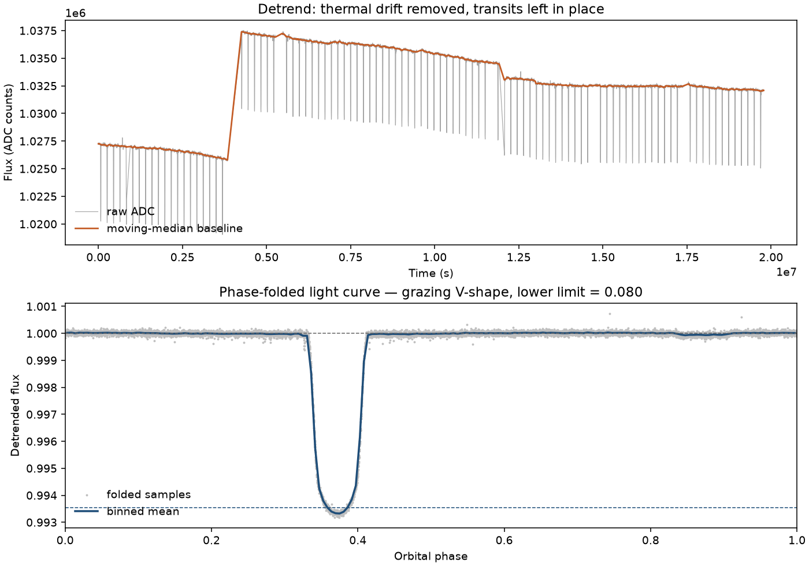

# Exoplanet Transit Pipeline

One Python program that recovers a planet-to-star radius ratio from a brightness log. A simulated bench rig, a Tinkercad serial capture, and a Kepler or TESS download all use the same two columns. After that, the measurement does not care which instrument produced the file.

The orbital period is an input: the motor setting on the rig, or the catalog period of a published planet. This pipeline does not search for the period, fit limb darkening, or replace the Kepler pipeline.

The full capstone write-up is in [Capstone_Project_Report.md](Capstone_Project_Report.md).

## What it measures

Every source is reduced to this CSV:

```text
timestamp_ms,raw_adc
```

`timestamp_ms` is milliseconds from the first good sample. `raw_adc` is the uncorrected brightness (ADC counts on the rig, SAP flux in electrons per second for Kepler). Gaps stay gaps. Nothing is interpolated.

The extractor then:

1. Removes the slow baseline with a two-pass moving median, so the dip is not treated as part of the drift.
2. Folds the series on the supplied period and bins the phase.
3. Reports transit depth, radius ratio \(R_p / R_\star\) (the square root of the depth), duration, and whether the stacked dip looks like a central U or a grazing V.

## Results included in this repo

| Record | What was recovered | Comparison |
| --- | --- | --- |
| Simulated rig, 9,000 samples at 50 Hz, six orbits of 30 s | Central U, depth 2.239%, \(R_p/R_\star = 0.1496 \pm 0.0003\), duration 3.00 s | Planted values: depth 2.250%, \(R_p/R_\star = 0.15\), chord 3.2 s |
| Kepler long-cadence SAP of HAT-P-7, quarters 0–3 (2 May–17 December 2009), 10,311 samples | Depth 0.645% (6,454 ppm), \(R_p/R_\star = 0.0803 \pm 0.0007\), duration 4.12 h | Published Kepler DR25 depth 6,674.7 ppm, duration 3.89 h. The flatness test calls the dip a grazing V; the published impact parameter is about 0.22, so that label is a limit of 30-minute sampling. |




The Kepler file keeps simple aperture photometry only. Corrected PDCSAP flux, uncertainties, and quality flags are not in the CSV. Later Kepler quarters are not in the file.

## Install

Python 3.10 or newer.

```bash
python3 -m venv .venv
source .venv/bin/activate
python3 -m pip install numpy matplotlib
```

`matplotlib` is only used to write the folded-curve plot. The numbers are still printed if it is missing.

Downloads from the Mikulski Archive for Space Telescopes need [Lightkurve](https://lightkurve.github.io/lightkurve/):

```bash
python3 -m pip install lightkurve
```

## Run

From this directory:

```bash
python3 transit_pipeline.py                  # Kepler HAT-P-7 sample already in the repo
python3 transit_pipeline.py demo tabletop    # simulate the rig, then measure it
python3 transit_pipeline.py demo kepler
python3 transit_pipeline.py simulate         # write tabletop_telemetry.csv only
python3 transit_pipeline.py extract tinkercad_telemetry.csv 10 4
python3 transit_pipeline.py tinkercad        # wiring guide and Arduino sketch
python3 transit_pipeline.py mast --target HAT-P-7 --mission Kepler --period 190489
```

`extract` takes the CSV, the orbital period in seconds, and the detrend window in seconds. The window must be longer than the transit and shorter than the drift you want to follow. For the included samples the periods are 30 s (tabletop) and 190489.14 s (HAT-P-7b, 2.204735 days).

`mast` searches MAST, writes `timestamp_ms,raw_adc`, and folds the file when `--period` is set. HAT-P-7b is about 190489 seconds.

## Tinkercad

`python3 transit_pipeline.py tinkercad` prints the circuit and the Arduino sketch. Tinkercad does not cast LED light onto a sensor, so the sketch applies a 2.25% dip when the servo crosses mid-orbit. Copy the Serial Monitor into `tinkercad_telemetry.csv`, then:

```bash
python3 transit_pipeline.py extract tinkercad_telemetry.csv 10 4
```

The orbit in that sketch is 10 seconds. A real bench version replaces the software dip with a phototransistor aimed at the LED and a bead on the servo.

## Credit

Kepler was a NASA Discovery mission. The HAT-P-7 light curves are public products from the [Mikulski Archive for Space Telescopes](https://archive.stsci.edu/). The host star is KIC 10666592. HAT-P-7b was announced by the HATNet project before Kepler launched. The MAST export uses Lightkurve.
